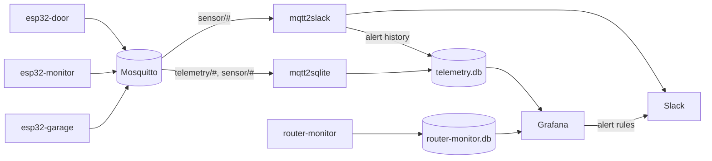

# IoT Platform Architecture

| | |
|---|---|
| Status | **Draft 0.1**: architecture agreed; the repository restructure is the next step |
| Date | 2026-11-21 |
| Scope | Shared server side for every home IoT project: ESP32 devices (shed, doors, garage) and the gateway router monitor |

## Revision History

| Rev | Date | Change |
|---|---|---|
| 0.1 | 2026-11-21 | First version: keep MQTT + SQLite + Grafana + small Python services; add an MQTT message contract, a shared firmware library, a FastAPI control service and remote access through a NetBird mesh VPN |

## Contents

1. [Goals](#1-goals)
2. [Where We Are Today](#2-where-we-are-today)
3. [Verdict on the Current Stack](#3-verdict-on-the-current-stack)
4. [Target Architecture](#4-target-architecture)
5. [The MQTT Contract](#5-the-mqtt-contract)
6. [Shared Firmware Library](#6-shared-firmware-library)
7. [Charts and Events in Grafana](#7-charts-and-events-in-grafana)
8. [Slack Alerts and Filtering](#8-slack-alerts-and-filtering)
9. [Device Control](#9-device-control)
10. [External Access](#10-external-access)
11. [Repository Layout (Proposed)](#11-repository-layout-proposed)
12. [Decisions](#12-decisions)
13. [Open Items](#13-open-items)

## 1. Goals

| # | Goal | Where it is met |
|---|---|---|
| G1 | Adding another ESP32 device is easy | [§5](#5-the-mqtt-contract), [§6](#6-shared-firmware-library) |
| G2 | Adding charts and events to Grafana is easy | [§7](#7-charts-and-events-in-grafana) |
| G3 | It is easy to filter which events reach Slack | [§8](#8-slack-alerts-and-filtering) |
| G4 | Device settings can be changed and devices controlled | [§9](#9-device-control) |
| G5 | Control and graphs can be reached from a browser or phone away from home | [§10](#10-external-access) |
| G6 | Lightweight and open source; runs on the existing server | Throughout |

**Constraints:**
- The server is a small fanless PC (Celeron N3350, 4 GB RAM, 32 GB eMMC) that already runs Mosquitto and Grafana. Write volume and memory use matter.
- The only internet connection is an AT&T Internet Air gateway (fixed wireless over cellular), which almost certainly sits behind carrier-grade NAT (CGNAT): no inbound connections from the internet.
- The code is also teaching material: small, readable and testable beats clever.

## 2. Where We Are Today

| Repository | Contents |
|---|---|
| `esp32-door` | Multi-door magnetic-switch sensor. MQTT over TLS, retained `sensor/<loc>/<name>`, `sensor/<loc>/status` with last will, telemetry, OTA, mDNS, web page and `/status` JSON |
| `esp32-monitor` | Shed solar/battery and environment monitor, same firmware design. Its `server/` folder is the de facto platform: `mqtt2sqlite.py`, `mqtt2slack.py` and the Grafana dashboards for the shed, doors and device health |
| `esp32-garage` | Garage door monitor and **controller** (Security+ 2.0). First device with commands: `cmd/garage/{left,right}`, `event/garage/…`; planned `garagebot` Slack app and a Mosquitto ACL |
| `garage-control` | Hardware design for the garage bus interface |
| `router-monitor` | Polls the gateway every 5 minutes into its own SQLite database; Grafana dashboards over views; Grafana alerting to Slack, with a host-wide contact point and policy tree in `deploy/grafana/shared/` |



**What works well:** the firmware repos already share one design and one topic convention. `mqtt2sqlite` creates tables and columns from the messages, so new telemetry needs no schema work. Dashboards and alert rules are generated by Python scripts and tested.

**What hurts:**
- Common firmware code (`wifi_diag.*`, `stats_util.h`, MQTT/TLS fallback, OTA, web) is **copied** into each device repo.
- Platform code lives inside one device repo (`esp32-monitor/server/`) and inside `router-monitor/deploy/grafana/shared/`.
- Two Slack paths (`mqtt2slack` and Grafana alerting) with different filter mechanisms.
- No general way to change device settings, and no remote access except the planned Slack bot.

## 3. Verdict on the Current Stack

**Keep MQTT + SQLite + Grafana + small Python services: the stack is right for this scale.** Formalize the message contract, and add a control service and a mesh VPN.

| Component | Decision | Reason |
|---|---|---|
| **Mosquitto (MQTT)** | Keep; the backbone for every device | Made for small devices: PubSubClient on the ESP32, retained last state, last will for online/offline, topic ACLs. Adding a device costs nothing on the server. Its configuration and ACL move into this repository |
| **SQLite** | Keep | About 50 MB a year, no server process, batched writes are kind to eMMC, easy to query from Python. Reconsider only at tens of writes per second or with several hosts (then VictoriaMetrics or TimescaleDB) |
| **Grafana** | Keep, for **viewing and metric alerts only** | Strong dashboards and alert engine; a poor control panel (awkward buttons, coarse permissions) |
| **Python services** | Keep, consolidated here | One purpose each, but one config style, one installer and one message contract |
| **Node-RED** | Retire | Replaced by `mqtt2slack`; logic in flows is hard to review and test in git |

## 4. Target Architecture


| Service | Language | Reads | Writes | Notes |
|---|---|---|---|---|
| Mosquitto | — | — | — | TLS listener for devices, ACL per MQTT user |
| `mqtt2sqlite` | Python | `telemetry/#`, `sensor/#`, `meta/#` | SQLite | From `esp32-monitor/server/` |
| Alert router | Python | `sensor/#`, `event/#` | Slack, alert history | Generalized `mqtt2slack` with a rules file |
| Control service | Python (FastAPI) | `meta/#`, `config/#`, `sensor/#`, `event/#` | `cmd/#`, `set/#`, audit table | Web UI and the `garagebot` Slack front end |
| Grafana | — | SQLite views | Slack (alert rules) | Existing install, `frser-sqlite-datasource` |
| `router-monitor` | Python | Gateway HTTP API | Its own SQLite | Stays a separate collector |
| Caddy | — | — | — | One host name and TLS for Grafana and the control service |
| NetBird | — | — | — | Mesh VPN client on the server and on phones/laptops |

## 5. The MQTT Contract

The contract is what makes a new device cheap: **a device that follows it gets storage, alerts, dashboards and controls without server code changes.** It will be written out in full as `docs/mqtt-contract.md` (versioned); this section is the outline.

`<loc>` is the location (`shed`, `garage`, `backyard`) and `<name>` is the sensor or actuator, as today. Every payload is JSON with `hub`, `sensor`, `timestamp`/`epoch` as the devices already send.

| Topic | Direction | Retained | Purpose | Status |
|---|---|---|---|---|
| `sensor/<loc>/status` | device → | yes | `ONLINE`; last will `OFFLINE` | In use |
| `sensor/<loc>/<name>` | device → | yes | Current state (`OK`, `OPEN`, `LOW`, …), on change and every 5 min | In use |
| `telemetry/<loc>/<name>` | device → | no | Aggregates every 5 min (avg/min/max); `type` selects the table | In use |
| `event/<loc>/<name>` | device → | no | Something happened (door moved, command result) | In use (garage) |
| `cmd/<loc>/<name>` | → device | **never** | One-shot action (`OPEN`, `CLOSE`, `STOP`, `REBOOT`) with `{"source": "...", "id": "..."}` | In use (garage) |
| `meta/<loc>` | device → | yes | **New.** Self-description: firmware version, sensors, telemetry fields and units, settings (name, type, range, unit) and commands | Proposed |
| `set/<loc>/<setting>` | → device | no | **New.** Request to change a setting | Proposed |
| `config/<loc>` | device → | yes | **New.** Current values of all settings, published after the device accepts (and saves to NVS) a change | Proposed |

**Rules:**
- Commands are never retained, so a reconnecting device does not repeat an old command.
- The device is the authority. It validates every `cmd/` and `set/`, refuses unsafe ones (for example, closing a garage door with an obstruction), and reports the result on `event/` or `config/`. The server never assumes a command worked.
- `meta/` follows the shape of Home Assistant MQTT discovery closely enough that discovery messages can be generated from it later without firmware changes.
- **ACL:** each device user may publish only its own `sensor/<loc>/#`, `telemetry/<loc>/#`, `event/<loc>/#`, `meta/<loc>`, `config/<loc>` and may subscribe to `cmd/<loc>/#` and `set/<loc>/#`. Only the control service's user may publish `cmd/#` and `set/#`.

**Adding a device:** write firmware with the shared library ([§6](#6-shared-firmware-library)), add a Mosquitto user and ACL entry, and optionally add dashboard panels and alert rules ([§7](#7-charts-and-events-in-grafana), [§8](#8-slack-alerts-and-filtering)). Storage and the control page work from the messages alone.

## 6. Shared Firmware Library

A new Arduino library repository, `esp32-iot-common`, holds what every device repeats today:

- WiFi connection, retries and diagnostics (`wifi_diag`), statistics (`stats_util`)
- MQTT with TLS and fallback, last will, `sensor/<loc>/status`
- NTP time, mDNS, OTA, the web page frame and `/status` JSON
- **New:** publishing `meta/<loc>`, handling `set/<loc>/<setting>` with validation and NVS storage, publishing `config/<loc>`

Device sketches keep only their own sensors, actuators and alarm logic. The library is installed into the Arduino `libraries/` folder (or added as a git submodule) and has its own version and CI build.

## 7. Charts and Events in Grafana

- **Generated dashboards.** Both projects already build dashboards with `build_dashboards.py` (Python → JSON, provisioned from files, checked by tests). Merge them into one generator in this repository with reusable helpers: a device-health row, a state timeline from `state_events`, a telemetry graph by `hub/sensor/field`, an events table. A new chart is a few lines of Python.
- **Views, not tables.** Grafana queries views (the router-monitor rule), so tables can change underneath without breaking dashboards.
- **Folders by domain:** Devices (health), Shed, Doors, Garage, Router. One SQLite datasource per database.
- **Device integrations.** A device repository may ship its own panels and alert rules in an `integration/` folder that the platform's generator and installer pick up ([§11](#11-repository-layout-proposed)).

## 8. Slack Alerts and Filtering

There are two kinds of alert, and each gets one owner and one place to filter:

| | Alert router (generalized `mqtt2slack`) | Grafana alerting |
|---|---|---|
| Handles | **States and events** from MQTT: door open, battery LOW, device OFFLINE, garage command results | **Metrics over time**: collector stale, throughput thresholds, battery trends |
| Filter in | `rules.toml` | Rule labels + the shared notification policy |
| Already has | Delays (`OFFLINE` after 15 min), reminders (`COLD` every 6 h), watchdog, outbox for restarts | Shared contact point `slack-alerts`, template, policy tree grouped by `alertname` and `project` |

**Alert router rules.** The fixed `[alerts]`/`[delays]`/`[reminders]` sections become an ordered list of rules; the first match wins and the default is explicit:

```toml
[[rule]]                       # never post routine states
match  = { state = ["OK", "ONLINE", "CLOSED"] }
action = "drop"

[[rule]]                       # garage: everything, to its own channel
match   = { topic = "event/garage/#" }
action  = "post"
channel = "garage"

[[rule]]                       # a door left open at night
match       = { topic = "sensor/backyard/#", state = "OPEN" }
action      = "post"
delay_min   = 10
quiet_hours = "23:00-06:00"    # outside quiet hours only, or "digest"

[[rule]]
match     = { state = "OFFLINE" }
action    = "post"
delay_min = 15
severity  = "warning"

[default]
action = "post"
```

Match fields: `topic` (MQTT wildcard), `hub`, `state`, `severity`. Actions: `post`, `drop`, `digest` (one summary message per period). Options: `channel`, `delay_min`, `repeat_h`, `quiet_hours`.

**Shared vocabulary:** both paths use the severities `critical`, `warning`, `info` and the same channel names. Grafana's host-wide alerting files move from `router-monitor/deploy/grafana/shared/` to this repository, as the router-monitor design (§5.6) already planned for when a second project adds alerts.

## 9. Device Control

A small **control service** (Python, FastAPI + paho-mqtt + SQLite; one process, well under 100 MB):

- **Device registry** from `meta/#`, `config/#`, `sensor/#` and `sensor/<loc>/status`: which devices exist, whether they are online, their state, settings and commands.
- **Web page generated from `meta/`:** server-rendered HTML with htmx (no JavaScript build), usable on a phone. A numeric setting becomes a slider or number box, a boolean a switch, a command a button (with a confirmation for anything that moves something). A new device appears with no UI code.
- **One command path:** the service publishes `cmd/` and `set/` as its own MQTT user, then waits for the device's `event/` or `config/` reply and shows the result (or a timeout).
- **Audit table** in SQLite: who, what, when, from where (web or Slack), result. Shown in Grafana.
- **`garagebot`** (Slack Socket Mode, outbound only) runs as a second front end in the same service, so Slack and the web page share permissions and the audit log.
- **Authentication:** its own login (users in a config file, password hashes), session cookies, and the mesh VPN in front ([§10](#10-external-access)).

**Alternatives not chosen:**
- **Home Assistant:** does all of this and has a phone app, but it is heavy for this server, duplicates Grafana and SQLite, and hides the mechanics (less useful for teaching). `esp32-garage` design decision D3 also chose not to use it. Keeping `meta/` close to Home Assistant discovery leaves the option open.
- **Node-RED Dashboard:** already installed and quick to build, but its logic lives in flows that are hard to test and review.
- **Grafana buttons:** awkward to build, coarse permissions, no confirmation step.

## 10. External Access

### The Problem

Away from home, a phone needs to reach Grafana and the control page on the home server. The usual answer (open a port on the router) does not work here: AT&T Internet Air is fixed wireless on the cellular network, and cellular carriers put customers behind **CGNAT**, so the gateway has no public IPv4 address and nothing on the internet can start a connection to it. Every workable solution has the home server **connect out**, as `garagebot` does with Slack Socket Mode.

### Decision: Mesh VPN, Hosted NetBird Now, Self-Hosted Later

The server and each phone or laptop run a **NetBird** client and join a private network. Traffic between them is WireGuard, encrypted end to end. From anywhere, `https://iot-server/grafana` and `https://iot-server/control` work as they do at home.

- **Nothing is exposed to the internet:** no port forwarding, no public login page. Only enrolled devices can connect.
- **One host name:** Caddy on the server serves Grafana and the control service under one name with TLS.
- **App logins stay on:** Grafana users, the control service login, and confirmations for dangerous commands.
- **Slack stays** the no-VPN path for alerts and quick garage commands.

### What the Third Party Does (and Does Not Do)

| Part | What it does | Hosted NetBird | Self-hosted later |
|---|---|---|---|
| Coordination (management + signal) | Keeps the device list, exchanges WireGuard public keys, enforces access rules | NetBird's servers | Our VPS |
| Data path | The actual traffic, WireGuard end to end | Direct between devices when possible | Same |
| Relay (fallback) | Carries traffic when devices cannot connect directly (more likely behind CGNAT); cannot decrypt it | NetBird's relays | Our VPS |

- **Privacy:** the provider cannot read our traffic; it does know which devices exist and when they connect.
- **Availability:** if the hosted service is down, existing connections usually continue; new logins and new devices fail until it is back.
- **Exit path:** all NetBird server components are open source. Moving them to a small VPS (about $4–6 a month) needs no client changes. That is the "self-host later" step.

### Alternatives

| Option | Why not (now) |
|---|---|
| Tailscale | Same model with the most polished apps, but the coordination service is closed source. A fine substitute if NetBird disappoints |
| Headscale | Open-source Tailscale coordination server; needs a VPS from day one |
| Plain WireGuard | Needs an inbound port, blocked by CGNAT on IPv4. **Might work over IPv6**: see [Open Items](#13-open-items) |
| Public tunnel (Cloudflare Tunnel, ngrok) | Puts the login page, and garage control, on the public internet; mostly closed source |

**Limitation of every option:** when the gateway is down, remote access is down too. router-monitor already accepts the same limit for its Slack alerts.

## 11. Repository Layout (Proposed)

To be settled in the next discussion.

| Repository | Role |
|---|---|
| `iot-platform` (this repository) | Everything server side and shared: Mosquitto configuration and ACL, the MQTT contract, `mqtt2sqlite`, alert router, control service (with `garagebot`), Grafana shared provisioning and the dashboard/alert generators, one installer, architecture documents. Takes over `esp32-monitor/server/` and `router-monitor/deploy/grafana/shared/` |
| `esp32-iot-common` (new) | Arduino library for all firmware ([§6](#6-shared-firmware-library)) |
| `esp32-door`, `esp32-monitor`, `esp32-garage` | Firmware only, plus an `integration/` folder (device manifest, dashboard panels, alert rules). `garage-control` moves into `esp32-garage/hardware/` |
| `router-monitor` | Stays a standalone collector; ships its dashboards and rules as an integration |

**Local checkout layout:** all repositories side by side under `~/src/iot/`:

```text
~/src/iot/
├── iot-platform/
├── esp32-iot-common/
├── esp32-door/
├── esp32-monitor/
├── esp32-garage/
└── router-monitor/
```

## 12. Decisions

| ID | Decision | Alternatives considered | Consequences |
|---|---|---|---|
| A1 | Keep MQTT + SQLite + Grafana + small Python services | Home Assistant; InfluxDB/VictoriaMetrics; TimescaleDB | Light and transparent; we write and maintain the glue code |
| A2 | The MQTT contract ([§5](#5-the-mqtt-contract)) is the integration point; devices describe themselves on `meta/` | Per-device server code | New devices need no server changes; firmware must publish `meta/` and handle `set/` |
| A3 | Shared Arduino library `esp32-iot-common` | Keep copying files | One fix reaches every device; the library needs versioning |
| A4 | Grafana for viewing and metric alerts only | Grafana as control UI | Control needs its own service (A6) |
| A5 | Two alert paths, one owner each: alert router (`rules.toml`) for states/events, Grafana for metrics; shared severities and channels | Everything in Grafana; everything in the router | Each alert type is filtered in one obvious place |
| A6 | Custom FastAPI control service with an htmx UI generated from `meta/`; hosts `garagebot` | Home Assistant; Node-RED Dashboard | Small, testable, good teaching material; we build the UI |
| A7 | Remote access through a NetBird mesh VPN, hosted now, self-hosted later | Tailscale; Headscale; plain WireGuard; public tunnel | No open ports; the hosted provider coordinates but cannot read traffic; open-source exit path |
| A8 | Retire Node-RED | Keep it | One fewer service on the server |

## 13. Open Items

| # | Item | Notes |
|---|---|---|
| O1 | Repository restructure | Next discussion: what moves where, in what order, without breaking the running services |
| O2 | MQTT contract details | `meta/` schema; `sensor/<loc>/status` kept or renamed; payload versioning |
| O3 | router-monitor events on MQTT | Optional; would add `paho-mqtt` to router-monitor, which is a design change there (its runtime dependency is `requests` only) |
| O4 | IPv6 test | Does the gateway give the server a public IPv6 address and allow an inbound IPv6 port? If so, plain WireGuard is possible with no third party |
| O5 | Retire Node-RED | Confirm nothing still depends on it |
| O6 | Control service security | Users and roles, which commands need confirmation, rate limits |
