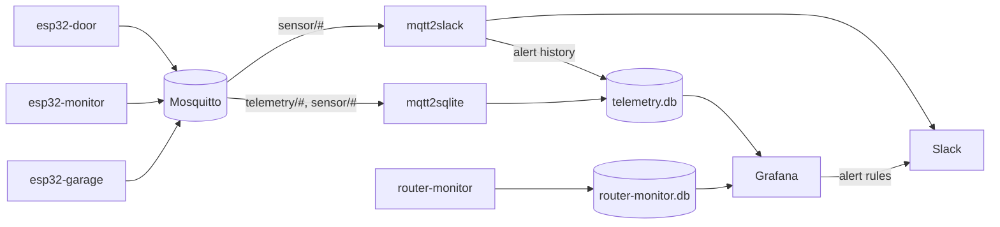
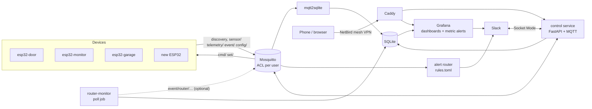

# IoT Platform Architecture

| | |
|---|---|
| Status | **Draft 0.5**: architecture agreed; the repository restructure is the next step |
| Date | 2026-11-21 |
| Scope | Shared server side for every home IoT project: ESP32 devices (shed, doors, garage) and the gateway router monitor |

## Revision History

| Rev | Date | Change |
|---|---|---|
| 0.1 | 2026-11-21 | First version: keep MQTT + SQLite + Grafana + small Python services; add an MQTT message contract, a shared firmware library, a FastAPI control service and remote access through a NetBird mesh VPN |
| 0.2 | 2026-11-21 | Security goal G7 and new §11 Security (threat model and protections per layer; decision A9; open items O7, O8). Constraint reworded: the code is small and testable (not teaching material). §12 states exactly what stays in `router-monitor` (collector, database, its dashboards and rules) and what moves here (host-wide Grafana alerting only). Sections 11–13 renumbered to 12–14 |
| 0.3 | 2026-11-21 | Goals G8 (memory-limited, low-power firmware) and G9 (future network and server monitoring); constraints for ESP32 memory and power; §6.1 compile-time feature selection with CI budgets, §6.2 power classes; §9 device registry fields, including the device page URL; plain-text MQTT fallback removed by decision (A9, O7); new §12 Network and Server Monitoring (preliminary); decisions A10, A11; open items O9, O10. Sections 12–14 renumbered to 13–15 |
| 0.4 | 2026-11-21 | Outcome of the [architecture review](architecture-review.md): self-description uses Home Assistant device-based discovery instead of our own `meta/` (§5.1, X2); fleet OTA (§6.3, M1); not ESPHome (X4); sleepy devices deferred (X5); two alert paths kept because Grafana's 1–2 min delay is too long (X3), silences and inhibition later (M5, M6); control UI in three phases (X1); new sections Testing and Operations (M2–M4 now; M9–M11 later) and Roadmap; decisions A12–A14. Sections renumbered |
| 0.5 | 2026-11-21 | §5.1 checked against the Home Assistant documentation source: `uniq_id` added to each component (required), availability mapped to the existing `sensor/<loc>/status` last will, cover state template lower-cased to match the defaults, table of the documented rules (topic, required keys, abbreviations, extra keys ignored, retained vs birth message, removal); O2 updated |

## Contents

1. [Goals](#1-goals)
2. [Where We Are Today](#2-where-we-are-today)
3. [Verdict on the Current Stack](#3-verdict-on-the-current-stack)
4. [Target Architecture](#4-target-architecture)
5. [The MQTT Contract](#5-the-mqtt-contract)
6. [Shared Firmware Library](#6-shared-firmware-library)
7. [Charts and Events in Grafana](#7-charts-and-events-in-grafana)
8. [Slack Alerts and Filtering](#8-slack-alerts-and-filtering)
9. [Device Control](#9-device-control)
10. [Testing and Operations](#10-testing-and-operations)
11. [External Access](#11-external-access)
12. [Security](#12-security)
13. [Network and Server Monitoring (Future)](#13-network-and-server-monitoring-future)
14. [Roadmap](#14-roadmap)
15. [Repository Layout (Proposed)](#15-repository-layout-proposed)
16. [Decisions](#16-decisions)
17. [Open Items](#17-open-items)

## 1. Goals

| # | Goal | Where it is met |
|---|---|---|
| G1 | Adding another ESP32 device is easy | [§5](#5-the-mqtt-contract), [§6](#6-shared-firmware-library) |
| G2 | Adding charts and events to Grafana is easy | [§7](#7-charts-and-events-in-grafana) |
| G3 | It is easy to filter which events reach Slack | [§8](#8-slack-alerts-and-filtering) |
| G4 | Device settings can be changed and devices controlled | [§9](#9-device-control) |
| G5 | Control and graphs can be reached from a browser or phone away from home | [§11](#11-external-access) |
| G6 | Lightweight and open source; runs on the existing server | Throughout |
| G7 | Reasonable protection against attackers: nothing reachable from the internet, every connection authenticated and encrypted, least privilege for devices and services, and a record of every control action | [§12](#12-security) |
| G8 | ESP32 firmware fits memory-limited boards (features can be left out per device) and uses little power | [§6](#6-shared-firmware-library) |
| G9 | *Future:* monitor the home network's servers, PCs and other devices in Grafana, with optional Slack alerts | [§13](#13-network-and-server-monitoring-future) |

**Constraints:**
- The server is a small fanless PC (Celeron N3350, 4 GB RAM, 32 GB eMMC) that already runs Mosquitto and Grafana. Write volume and memory use matter.
- The only internet connection is an AT&T Internet Air gateway (fixed wireless over cellular), which almost certainly sits behind carrier-grade NAT (CGNAT): no inbound connections from the internet.
- The code is small and testable: small single-purpose services and firmware modules, pure functions tested against fixtures, I/O kept at the edges.
- The ESP32 devices have little memory (about 320 KB of usable RAM and 1.2–1.9 MB of flash per OTA app slot on a 4 MB board, with TLS alone taking roughly 40–50 KB of heap). A shared library must not force every feature onto every device.
- The ESP32 devices should use little power. Some run on mains power, but others (the shed monitor) run on solar and battery, where every milliamp counts.

## 2. Where We Are Today

| Repository | Contents |
|---|---|
| `esp32-door` | Multi-door magnetic-switch sensor. MQTT over TLS, retained `sensor/<loc>/<name>`, `sensor/<loc>/status` with last will, telemetry, OTA, mDNS, web page and `/status` JSON |
| `esp32-monitor` | Shed solar/battery and environment monitor, same firmware design. Its `server/` folder is the de facto platform: `mqtt2sqlite.py`, `mqtt2slack.py` and the Grafana dashboards for the shed, doors and device health |
| `esp32-garage` | Garage door monitor and **controller** (Security+ 2.0). First device with commands: `cmd/garage/{left,right}`, `event/garage/…`; planned `garagebot` Slack app and a Mosquitto ACL |
| `garage-control` | Hardware design for the garage bus interface |
| `router-monitor` | Polls the gateway every 5 minutes into its own SQLite database; Grafana dashboards over views; Grafana alerting to Slack, with a host-wide contact point and policy tree in `deploy/grafana/shared/` |



**What works well:** the firmware repos already share one design and one topic convention. `mqtt2sqlite` creates tables and columns from the messages, so new telemetry needs no schema work. Dashboards and alert rules are generated by Python scripts and tested.

**What hurts:**
- Common firmware code (`wifi_diag.*`, `stats_util.h`, MQTT/TLS fallback, OTA, web) is **copied** into each device repo.
- Platform code lives inside one device repo (`esp32-monitor/server/`) and inside `router-monitor/deploy/grafana/shared/`.
- Two Slack paths (`mqtt2slack` and Grafana alerting) with different filter mechanisms.
- No general way to change device settings, and no remote access except the planned Slack bot.

## 3. Verdict on the Current Stack

**Keep MQTT + SQLite + Grafana + small Python services: the stack is right for this scale.** Formalize the message contract, and add a control service and a mesh VPN.

| Component | Decision | Reason |
|---|---|---|
| **Mosquitto (MQTT)** | Keep; the backbone for every device | Made for small devices: PubSubClient on the ESP32, retained last state, last will for online/offline, topic ACLs. Adding a device costs nothing on the server. Its configuration and ACL move into this repository |
| **SQLite** | Keep | About 50 MB a year, no server process, batched writes are kind to eMMC, easy to query from Python. Reconsider only at tens of writes per second or with several hosts (then VictoriaMetrics or TimescaleDB) |
| **Grafana** | Keep, for **viewing and metric alerts only** | Strong dashboards and alert engine; a poor control panel (awkward buttons, coarse permissions) |
| **Python services** | Keep, consolidated here | One purpose each, but one config style, one installer and one message contract |
| **Node-RED** | Retire | Replaced by `mqtt2slack`; logic in flows is hard to review and test in git |

## 4. Target Architecture



| Service | Language | Reads | Writes | Notes |
|---|---|---|---|---|
| Mosquitto | — | — | — | TLS listener for devices, ACL per MQTT user |
| `mqtt2sqlite` | Python | `telemetry/#`, `sensor/#` | SQLite | From `esp32-monitor/server/` |
| Alert router | Python | `sensor/#`, `event/#` | Slack, alert history | Generalized `mqtt2slack` with a rules file |
| Control service | Python (FastAPI) | `homeassistant/device/+/config`, `config/#`, `sensor/#`, `event/#` | `cmd/#`, `set/#`, audit table | Web UI and the `garagebot` Slack front end |
| Grafana | — | SQLite views | Slack (alert rules) | Existing install, `frser-sqlite-datasource` |
| `router-monitor` | Python | Gateway HTTP API | Its own SQLite | Stays a separate collector |
| Caddy | — | — | — | One host name and TLS for Grafana and the control service |
| NetBird | — | — | — | Mesh VPN client on the server and on phones/laptops |

## 5. The MQTT Contract

The contract is what makes a new device cheap: **a device that follows it gets storage, alerts, dashboards and controls without server code changes.** It will be written out in full as `docs/mqtt-contract.md` (versioned); this section is the outline.

`<loc>` is the location (`shed`, `garage`, `backyard`) and `<name>` is the sensor or actuator, as today. Every payload is JSON with `hub`, `sensor`, `timestamp`/`epoch` as the devices already send.

| Topic | Direction | Retained | Purpose | Status |
|---|---|---|---|---|
| `sensor/<loc>/status` | device → | yes | `ONLINE`; last will `OFFLINE` | In use |
| `sensor/<loc>/<name>` | device → | yes | Current state (`OK`, `OPEN`, `LOW`, …), on change and every 5 min | In use |
| `telemetry/<loc>/<name>` | device → | no | Aggregates every 5 min (avg/min/max); `type` selects the table | In use |
| `event/<loc>/<name>` | device → | no | Something happened (door moved, command result) | In use (garage) |
| `cmd/<loc>/<name>` | → device | **never** | One-shot action (`OPEN`, `CLOSE`, `STOP`, `REBOOT`) with `{"source": "...", "id": "..."}` | In use (garage) |
| `homeassistant/device/<hub>/config` | device → | yes | **New.** Self-description in Home Assistant's device-based discovery format ([§5.1](#51-self-description-home-assistant-discovery)): device name, model, firmware, page URL, and each sensor, setting and command with the topics above | Proposed |
| `set/<loc>/<setting>` | → device | no | **New.** Request to change a setting | Proposed |
| `config/<loc>` | device → | yes | **New.** Current values of all settings, published after the device accepts (and saves to NVS) a change | Proposed |

**Rules:**
- Commands are never retained, so a reconnecting device does not repeat an old command. `set/` messages are retained only for sleepy devices ([§6.2](#62-low-power)), which pick them up when they wake and then clear them.
- Devices connect with **TLS only**; there is no plain-text fallback (decision A9).
- The device is the authority. It validates every `cmd/` and `set/`, refuses unsafe ones (for example, closing a garage door with an obstruction), and reports the result on `event/` or `config/`. The server never assumes a command worked.
- **ACL:** each device user may publish only its own `sensor/<loc>/#`, `telemetry/<loc>/#`, `event/<loc>/#`, `config/<loc>`, `homeassistant/device/<hub>/config` and may subscribe to `cmd/<loc>/#` and `set/<loc>/#`. Only the control service's user may publish `cmd/#` and `set/#`.

**Adding a device:** write firmware with the shared library ([§6](#6-shared-firmware-library)), add a Mosquitto user and ACL entry, and optionally add dashboard panels and alert rules ([§7](#7-charts-and-events-in-grafana), [§8](#8-slack-alerts-and-filtering)). Storage and the control page work from the messages alone.

### 5.1 Self-Description (Home Assistant Discovery)

Instead of designing our own self-description schema, devices use **Home Assistant's MQTT discovery format** (review item X2). It is already specified and documented, it can point at *our existing topics* (no topic changes), and Home Assistant, openHAB and other tools understand it. We use it as a format only; Home Assistant itself is not part of the platform.

We use the **device-based** variant ("device discovery"): **one retained message per device** on `homeassistant/device/<hub>/config`, with abbreviated keys, rather than one message per sensor. A shortened example for the garage:

```json
{
  "dev":  {"ids": "garage00", "name": "Garage", "mdl": "ESP32-DevKitC-V4",
           "sw": "2.3.0", "cu": "http://192.168.1.42/"},
  "o":    {"name": "esp32-iot-common", "sw": "1.0.0"},
  "avty_t": "sensor/garage/status", "pl_avail": "ONLINE", "pl_not_avail": "OFFLINE",
  "cmps": {
    "left":         {"p": "cover", "uniq_id": "garage00_left",
                     "stat_t": "sensor/garage/left", "cmd_t": "cmd/garage/left",
                     "val_tpl": "{{ value_json.opener | lower }}"},
    "close_warn_s": {"p": "number", "uniq_id": "garage00_close_warn_s",
                     "stat_t": "config/garage", "cmd_t": "set/garage/close_warn_s",
                     "val_tpl": "{{ value_json.close_warn_s }}",
                     "min": 0, "max": 120, "step": 1, "unit_of_meas": "s"},
    "reboot":       {"p": "button", "uniq_id": "garage00_reboot",
                     "cmd_t": "cmd/garage/device", "pl_prs": "REBOOT"}
  }
}
```

**Rules from the Home Assistant documentation** (checked 2026-11-21 against the official docs source, `home-assistant/home-assistant.io`, `source/_integrations/mqtt.markdown`, `number.mqtt`, `button.mqtt`, `cover.mqtt`):

| Rule | Detail |
|---|---|
| Topic | `<discovery_prefix>/device/<object_id>/config`; prefix `homeassistant`; `<object_id>` from `[a-zA-Z0-9_-]` → we use the hub name |
| Required at the root | `dev` (device) and `o` (origin, with at least `name`); components in `cmps` |
| Required per component | `p` (platform) and, for entities, `uniq_id`; component keys unique within the device |
| Our own topics | Every `*_topic` can be any topic, so `stat_t`/`cmd_t` point at the existing `sensor/`, `cmd/`, `config/`, `set/` topics. A base topic `~` can shorten repeated prefixes |
| Abbreviations | Allowed everywhere "to conserve memory … from memory constrained devices" (`stat_t`, `cmd_t`, `val_tpl`, `uniq_id`, `unit_of_meas`, `pl_prs`, `avty_t`, `cu`, `sw`, `mdl`, `ids`, …) |
| Extra keys | "unknown configuration keys are allowed but ignored", so a field of our own can be added if ever needed |
| Availability | Shared `avty_t` / `pl_avail` / `pl_not_avail` at the root: points at our existing `sensor/<loc>/status` with `ONLINE` / `OFFLINE` |
| Retained | Allowed; the docs prefer re-sending when Home Assistant publishes `online` on `homeassistant/status`. Not needed while Home Assistant is not used; the library may subscribe to it later |
| Remove a device | Empty retained payload on the discovery topic. One component: send it with only `p`, then send the payload without it |

| Need | Discovery feature |
|---|---|
| Device page URL for the registry | `configuration_url` (`cu`): `http://` or `https://` |
| Firmware version | `sw_version` (`sw`) |
| Settings with type and range | `number` (`min` default 1, `max` default 100, `step` default 1, unit, mode), `switch`, `select` |
| Commands | `button` (`pl_prs`, default `PRESS`), `cover` (`pl_open`/`pl_cls`/`pl_stop` default `OPEN`/`CLOSE`/`STOP`, the garage's own commands) |
| Door state | `cover` states default to lower case (`open`, `closed`, `opening`, `closing`, `stopped`), so the template lower-cases the garage's `opener` field |
| Readings and states | `sensor`, `binary_sensor` |

**Check against our needs:** the format meets them and is not verbose for one device (about 1–2 KB with abbreviations). On the ESP32 the message is written in pieces (`beginPublish` / `write` / `endPublish`) so no large buffer is needed, and it can be switched off with `IOT_FEATURE_DISCOVERY`. **If the format ever stops fitting, we fall back to a small `meta/<loc>` message of our own.**

## 6. Shared Firmware Library

A new Arduino library repository, `esp32-iot-common`, holds what every device repeats today:

- WiFi connection, retries and diagnostics (`wifi_diag`), statistics (`stats_util`)
- MQTT with TLS and fallback, last will, `sensor/<loc>/status`
- NTP time, mDNS, OTA, the web page frame and `/status` JSON
- **New:** publishing the discovery message ([§5.1](#51-self-description-home-assistant-discovery)), handling `set/<loc>/<setting>` with validation and NVS storage, publishing `config/<loc>`

Device sketches keep only their own sensors, actuators and alarm logic. The library is installed into the Arduino `libraries/` folder (or added as a git submodule) and has its own version and CI build.

### 6.1 Leaving Features Out (Memory)

Each feature is a separate module switched on or off **at compile time** in the device's `settings.h`, so a disabled feature costs no flash and no RAM:

```cpp
// settings.h (per device)
#define IOT_FEATURE_WEB        1   // web page and /status JSON
#define IOT_FEATURE_OTA        1   // over-the-air update
#define IOT_FEATURE_MDNS       1
#define IOT_FEATURE_WIFI_DIAG  0   // WiFi survey and antenna test pages
#define IOT_FEATURE_SETTINGS   1   // set/ and config/ topics, NVS storage
#define IOT_FEATURE_DISCOVERY  1   // self-description (§5.1)
```

- **Required core** (always on): WiFi, MQTT over TLS, NTP, last will/status. Everything else is optional.
- **Defaults** suit a mains-powered board; a small or battery device turns features off.
- **Budgets checked in CI:** the build prints flash and static RAM use per device, and fails above a set limit (for example 85 % of the app slot), so growth is noticed when it happens. The device reports `free_heap` and `min_free_heap` in telemetry (already done), and the Device Health dashboard shows them.
- **Memory habits in the library:** fixed-size buffers instead of `String` concatenation, `PROGMEM` for web pages, one TLS client reused, JSON written into a fixed buffer.
- The discovery message lists only the sensors, settings and commands compiled in, so the control service shows only what the device can do.

### 6.2 Low Power

> **Deferred** until the first battery-powered device (review item X5). Until then every device is *always connected*; the library rules at the end of this section apply now.

Devices will have one of two **power classes**:

| Class | Examples | How it saves power | Consequence |
|---|---|---|---|
| **Always connected** | Garage (must react to commands), doors | WiFi modem sleep (`WiFi.setSleep(true)`), CPU at 80 MHz, Bluetooth off, sensors read only as often as needed, telemetry aggregated on the device and sent every 5 minutes | Commands arrive within about a second |
| **Sleepy** | A future battery sensor; possibly the shed monitor | Deep sleep between readings; wakes on a timer or a GPIO (door switch), connects, publishes, checks for settings, sleeps again | Cannot receive commands while asleep: its settings use **retained** `set/` messages, which it reads on waking, and the control page shows "applies at next wake-up" |

Library rules for both classes: no busy loops (block on events or `delay()`, which lets the CPU idle), Bluetooth off unless used, the radio used in short bursts, LEDs off or dimmed by default, and brown-out and low-battery states reported on `sensor/<loc>/status`.

### 6.3 Firmware Updates (Fleet OTA)

Today each device is flashed from the Arduino IDE. With several devices, the platform manages updates centrally (review item M1):

1. **CI builds** each device's firmware on a tag (the device repos already build in GitHub Actions) and publishes the binary with its version and SHA-256.
2. **The server keeps a firmware catalog**: one folder per device type, served over HTTPS on the LAN by Caddy.
3. **The control service** shows, in the registry, the running version against the latest one, and sends `cmd/<loc>/device` with `{"cmd": "OTA", "url": ..., "sha256": ..., "version": ...}`.
4. **The device** downloads the image over HTTPS (`HTTPUpdate`), checks the hash, writes it to the spare OTA slot, reboots, and reports the result on `event/<loc>/device`. If the new firmware does not reach MQTT after the restart, the ESP32's rollback returns to the previous slot.

Arduino IDE / `ArduinoOTA` stays available for development. Signed firmware images are a later option.

**Not ESPHome.** ESPHome would provide much of this library (feature selection, OTA, discovery), but the existing firmware works well and is tested, and it would add a large dependency that may not fit our devices (review item X4).

## 7. Charts and Events in Grafana

- **Generated dashboards.** Both projects already build dashboards with `build_dashboards.py` (Python → JSON, provisioned from files, checked by tests). Merge them into one generator in this repository with reusable helpers: a device-health row, a state timeline from `state_events`, a telemetry graph by `hub/sensor/field`, an events table. A new chart is a few lines of Python.
- **Views, not tables.** Grafana queries views (the router-monitor rule), so tables can change underneath without breaking dashboards.
- **Folders by domain:** Devices (health), Shed, Doors, Garage, Router. One SQLite datasource per database.
- **Device integrations.** A device repository may ship its own panels and alert rules in an `integration/` folder that the platform's generator and installer pick up ([§15](#15-repository-layout-proposed)).

## 8. Slack Alerts and Filtering

There are two kinds of alert, and each gets one owner and one place to filter:

| | Alert router (generalized `mqtt2slack`) | Grafana alerting |
|---|---|---|
| Handles | **States and events** from MQTT: door open, battery LOW, device OFFLINE, garage command results | **Metrics over time**: collector stale, throughput thresholds, battery trends |
| Filter in | `rules.toml` | Rule labels + the shared notification policy |
| Already has | Delays (`OFFLINE` after 15 min), reminders (`COLD` every 6 h), watchdog, outbox for restarts | Shared contact point `slack-alerts`, template, policy tree grouped by `alertname` and `project` |

**Alert router rules.** The fixed `[alerts]`/`[delays]`/`[reminders]` sections become an ordered list of rules; the first match wins and the default is explicit:

```toml
[[rule]]                       # never post routine states
match  = { state = ["OK", "ONLINE", "CLOSED"] }
action = "drop"

[[rule]]                       # garage: everything, to its own channel
match   = { topic = "event/garage/#" }
action  = "post"
channel = "garage"

[[rule]]                       # a door left open at night
match       = { topic = "sensor/backyard/#", state = "OPEN" }
action      = "post"
delay_min   = 10
quiet_hours = "23:00-06:00"    # outside quiet hours only, or "digest"

[[rule]]
match     = { state = "OFFLINE" }
action    = "post"
delay_min = 15
severity  = "warning"

[default]
action = "post"
```

Match fields: `topic` (MQTT wildcard), `hub`, `state`, `severity`. Actions: `post`, `drop`, `digest` (one summary message per period). Options: `channel`, `delay_min`, `repeat_h`, `quiet_hours`.

**Shared vocabulary:** both paths use the severities `critical`, `warning`, `info` and the same channel names. Grafana's host-wide alerting files move from `router-monitor/deploy/grafana/shared/` to this repository, as the router-monitor design (§5.6) already planned for when a second project adds alerts.

**Why two paths (review item X3).** Grafana alerting could do the filtering (matchers, mute timings, pending periods, silences), but its alerts come from the database: batching in `mqtt2sqlite` plus the evaluation interval delays them by 1–2 minutes, which is too long for door and garage events. So state and event alerts stay in the alert router (immediate), and Grafana keeps the metric rules.

**Later (wanted, not yet scheduled):**
- **Silences and maintenance mode** (M5): a `silence` rule with an expiry, set from Slack (`/silence shed 2h`) or from the registry, so working in the shed does not flood Slack.
- **Inhibition** (M6): when all devices go OFFLINE together, post one "broker or network down" message instead of one per device.

## 9. Device Control

A small **control service** (Python, FastAPI + paho-mqtt + SQLite; one process, well under 100 MB):

- **Device registry** built from the discovery messages, `config/#`, `sensor/#` and `sensor/<loc>/status`, stored in SQLite (so Grafana can show it too):

  | Field | Source | Example |
  |---|---|---|
  | Location, hub | discovery | `garage`, `garage00` |
  | Description, board, firmware version | discovery (device block) | Garage door controller, DevKitC-V4, 2.3.0 |
  | **Device page URL** | discovery (`configuration_url`); the device knows its own address | `http://garage00.local/` (link to the device's own web page) |
  | IP address | `/status` JSON or last connection | `192.168.1.42` |
  | Firmware: running vs latest | discovery, OTA catalog ([§6.3](#63-firmware-updates-fleet-ota)) | 2.3.0 → 2.3.1 available |
  | Online/offline, last seen | `sensor/<loc>/status`, any message | ONLINE, 12 s ago |
  | Current states | `sensor/<loc>/#` | left: CLOSED, right: OPEN |
  | Settings (current values), commands | `config/<loc>`, discovery | `close_warn_s = 30`; OPEN/CLOSE/STOP |

  The registry page lists every device with a link to its own web page. The link uses the IP address as well as the `.local` name, because mDNS names do not resolve over the VPN. Reaching the device pages from outside the home needs a NetBird route to the IoT addresses ([§11](#11-external-access)); the device pages stay read-only or password-protected ([§12](#12-security)).
- **Web page, built in phases** (review item X1). Server-rendered HTML with htmx (no JavaScript build), usable on a phone:

  | Phase | Contents | When |
  |---|---|---|
  | 1 | Registry page: every device, online/offline, states, firmware, link to its page | First |
  | 2 | Hand-written garage controls (OPEN/CLOSE/STOP with confirmation) and garage settings | With `esp32-garage` M4 |
  | 3 | Controls **generated from the discovery messages**: a `number` becomes a slider or number box, a `switch` a toggle, a `button` a button (confirmation for anything that moves something) | When a second or third device has controls |
- **One command path:** the service publishes `cmd/` and `set/` as its own MQTT user, then waits for the device's `event/` or `config/` reply and shows the result (or a timeout).
- **Audit table** in SQLite: who, what, when, from where (web or Slack), result. Shown in Grafana.
- **`garagebot`** (Slack Socket Mode, outbound only) runs as a second front end in the same service, so Slack and the web page share permissions and the audit log.
- **Authentication:** its own login (users in a config file, password hashes), session cookies, and the mesh VPN in front ([§11](#11-external-access)).

**Alternatives not chosen:**
- **Home Assistant:** does all of this and has a phone app, but it is heavy for this server, duplicates Grafana and SQLite, and hides the mechanics (harder to test and to keep small). `esp32-garage` design decision D3 also chose not to use it. Using Home Assistant's discovery format for self-description leaves the option open.
- **Node-RED Dashboard:** already installed and quick to build, but its logic lives in flows that are hard to test and review.
- **Grafana buttons:** awkward to build, coarse permissions, no confirmation step.

**Not now:**
- **Full desired-state tracking** ("device shadow", M7): the registry shows the *reported* settings from `config/`; it does not keep a separate desired value and a pending state.
- **Automations and schedules** (M8, wanted later): when they come, safety-related behavior (for example garage auto-close) goes **on the device**; cross-device rules ("warn at 22:00 if a door is open") go in a small scheduler in the control service.

## 10. Testing and Operations

These make the platform dependable and keep "add a device" easy.

### Now

| Item | What | Where |
|---|---|---|
| **Contract schemas and checker** (M3) | A JSON Schema for every message type in the contract; a `contract-check` tool that subscribes to the broker and reports messages that do not match; the same schemas used in the services' tests | `iot-platform/contract/` |
| **Device simulator** (M3) | A Python fake device that speaks the contract (status, states, telemetry, discovery, commands, settings) so services and the control UI can be tested without hardware; builds on `esp32-garage`'s simulated drivers and router-monitor's fake gateway approach | `iot-platform/tools/` |
| **Platform self-monitoring** (M2) | Each service publishes a heartbeat (`status/platform/<service>`) and its counters; Grafana alerts on a stale service, Mosquitto down, disk above 85 %, database growth. An outside dead-man's switch (Healthchecks, open source, hosted free tier or self-hosted later) alerts when the server itself goes quiet | Services, Grafana rules |
| **Device onboarding** (M4) | `add-device <hub> <loc>`: creates the MQTT user and password, adds the ACL entries, writes the device's `secrets.h` from the template (outside git), and lists the next steps | `iot-platform/tools/add-device` |

### Later (wanted, not yet scheduled)

| Item | What |
|---|---|
| **Server configuration as code and restore test** (M9) | One installer for the whole host (Mosquitto, Grafana, services, firewall, NetBird, Caddy); restore from backup onto a spare machine or VM once to prove it works |
| **Local development stack** (M10) | `docker compose` with Mosquitto, Grafana and the services, for development only; production stays systemd |
| **Certificate lifecycle** (M11) | Record the CA and broker certificate expiry dates, alert 30 days ahead, document renewal (long-lived CA on the devices, shorter-lived broker certificate) |

**Not now:** a second notification channel such as ntfy (M12).

## 11. External Access

### The Problem

Away from home, a phone needs to reach Grafana and the control page on the home server. The usual answer (open a port on the router) does not work here: AT&T Internet Air is fixed wireless on the cellular network, and cellular carriers put customers behind **CGNAT**, so the gateway has no public IPv4 address and nothing on the internet can start a connection to it. Every workable solution has the home server **connect out**, as `garagebot` does with Slack Socket Mode.

### Decision: Mesh VPN, Hosted NetBird Now, Self-Hosted Later

The server and each phone or laptop run a **NetBird** client and join a private network. Traffic between them is WireGuard, encrypted end to end. From anywhere, `https://iot-server/grafana` and `https://iot-server/control` work as they do at home.

- **Nothing is exposed to the internet:** no port forwarding, no public login page. Only enrolled devices can connect.
- **One host name:** Caddy on the server serves Grafana and the control service under one name with TLS.
- **App logins stay on:** Grafana users, the control service login, and confirmations for dangerous commands.
- **Slack stays** the no-VPN path for alerts and quick garage commands.

### What the Third Party Does (and Does Not Do)

| Part | What it does | Hosted NetBird | Self-hosted later |
|---|---|---|---|
| Coordination (management + signal) | Keeps the device list, exchanges WireGuard public keys, enforces access rules | NetBird's servers | Our VPS |
| Data path | The actual traffic, WireGuard end to end | Direct between devices when possible | Same |
| Relay (fallback) | Carries traffic when devices cannot connect directly (more likely behind CGNAT); cannot decrypt it | NetBird's relays | Our VPS |

- **Privacy:** the provider cannot read our traffic; it does know which devices exist and when they connect.
- **Availability:** if the hosted service is down, existing connections usually continue; new logins and new devices fail until it is back.
- **Exit path:** all NetBird server components are open source. Moving them to a small VPS (about $4–6 a month) needs no client changes. That is the "self-host later" step.

### Alternatives

| Option | Why not (now) |
|---|---|
| Tailscale | Same model with the most polished apps, but the coordination service is closed source. A fine substitute if NetBird disappoints |
| Headscale | Open-source Tailscale coordination server; needs a VPS from day one |
| Plain WireGuard | Needs an inbound port, blocked by CGNAT on IPv4. **Might work over IPv6**: see [Open Items](#17-open-items) |
| Public tunnel (Cloudflare Tunnel, ngrok) | Puts the login page, and garage control, on the public internet; mostly closed source |

**Limitation of every option:** when the gateway is down, remote access is down too. router-monitor already accepts the same limit for its Slack alerts.

## 12. Security

The aim is **reasonable protection for a home system**: an attacker on the internet should find nothing to attack, and an attacker who gets onto the home network (a guest, a compromised gadget, a stolen phone) should not be able to control devices or read secrets. Defending against physical access to the hardware or a determined, well-funded attacker is out of scope.

### Threats

| # | Threat | Main protection |
|---|---|---|
| T1 | Someone on the internet probes the home | Nothing listens publicly: CGNAT, no port forwarding, remote access only through the mesh VPN ([§11](#11-external-access)) |
| T2 | Someone on the home WiFi (guest, compromised smart TV or ESP32) sniffs or sends MQTT messages | TLS on MQTT, no anonymous login, one user per device, topic ACLs; only the control service may publish `cmd/#` and `set/#` |
| T3 | A device is compromised or its credentials leak | Its MQTT user can publish only its own topics and cannot command other devices; revoke by deleting the user |
| T4 | A phone or laptop is lost or stolen | Remove it from NetBird; the control service and Grafana still need their own logins |
| T5 | Someone gets into Slack (or Slack is misused) | `garagebot` accepts commands only from a list of Slack user IDs; workspace two-factor authentication; every command is audited |
| T6 | A secret ends up in git | Secrets live only in config files outside the repositories (mode 600/640); a test fails if a token or webhook URL appears in a tracked file (as router-monitor does) |
| T7 | Unpatched software is exploited | Automatic security updates on the server; pinned, reviewed versions of Python packages and Grafana plugins |
| T8 | A bad command damages something (garage door closes on a car) | The device enforces safety itself and refuses unsafe commands; confirmation in the UI; the server never assumes success |

### Protections by Layer

| Layer | Protection |
|---|---|
| **Network** | No public listeners. Firewall (`ufw`) on the server allows only the MQTT TLS port, Caddy (HTTPS) and SSH from the LAN and the VPN. Optional: put the ESP32s on a separate guest/IoT WiFi network if the gateway supports it |
| **Remote access** | NetBird mesh VPN only; access rules let phones reach Caddy, not every port on the server; devices removed when lost |
| **MQTT broker** | TLS listener for the LAN; plain-text listener on `localhost` only (for local services); `allow_anonymous false`; one user per device and per service; ACL per [§5](#5-the-mqtt-contract) |
| **Devices** | MQTT over TLS only (the plain-text fallback is removed); per-device MQTT credentials and CA certificate in `secrets.h`/`ca_cert.h` (not in git); OTA protected by a password; the device web page is read-only or password-protected for anything that changes state; commands and settings validated on the device |
| **Web (Caddy, control service, Grafana)** | HTTPS everywhere; control service login with hashed passwords, secure session cookies, CSRF protection and confirmation for actions that move hardware; Grafana anonymous access off, admin password changed, other users as Viewers |
| **Slack** | Bot tokens in config files outside git; Socket Mode (outbound only); allow-list of user IDs for commands |
| **Server** | Each service runs as its own system user with systemd hardening (`NoNewPrivileges`, `ProtectSystem=strict`, `ProtectHome`, `PrivateTmp`, only the directories it needs writable); SSH by key only; automatic security updates |
| **Audit and detection** | Every command and setting change in the audit table (who, what, when, from where, result), shown in Grafana; Slack alert for a device that goes OFFLINE or a failed login burst |
| **Recovery** | Nightly SQLite backups (as router-monitor does); configuration in git; secrets kept separately |

### Known Gaps

- **Plain-text fallback in the current firmware.** Today's devices fall back to unencrypted MQTT if TLS fails, which would let an attacker on the LAN force plain text (T2). It was a debugging aid and is no longer needed: **decided to remove it** (A9). Until the firmware is updated (O7), the gap remains.
- **No outside monitoring of the server itself.** If the server is down, nothing alerts (the same gap router-monitor accepts).

## 13. Network and Server Monitoring (Future)

> **Preliminary.** The requirements are not written yet (open item O9). This section records the intended shape so the IoT work does not block it.

**Goal:** show the health of the home network's servers, PCs and other devices (NAS, printers, access points, TVs) in Grafana, with optional Slack alerts. It is **separate from the IoT controls**: no control service, no Caddy, no MQTT commands. Remote viewing comes for free through Grafana over the VPN.

**Likely measurements:**

| Kind | Applies to | Examples |
|---|---|---|
| Reachability | Every device with an address | Up/down by ping, response time, packet loss |
| Services | Servers | HTTP/TLS checks (certificate expiry), SSH, DNS, Mosquitto, Grafana |
| Host metrics | Linux servers and PCs | CPU, memory, disk space, temperature, load, uptime, systemd failed units |
| Inventory | The network | New or unknown device appeared on the LAN (from the gateway's device list or an ARP scan) |

**Preliminary direction:**

- **A separate collector project** (`net-monitor`, own repository), like `router-monitor`: it owns its collection, storage and dashboards, and uses only the shared Grafana alerting (contact point and policy, label `project = net-monitor`) from this repository.
- **Collection:** a host list in a config file. Use standard open-source agents where they fit (Prometheus `node_exporter` on Linux hosts for host metrics; ping/HTTP checks from the server, for example with `blackbox_exporter`) rather than writing them.
- **Storage, to be chosen with the requirements:**

  | Option | When it fits |
  |---|---|
  | **SQLite + small Python poller** (as `router-monitor`) | A few dozen hosts, ping and service checks every minute or more; one technology across the platform |
  | **VictoriaMetrics (single node)** | Host metrics from agents at 15–60 s intervals; Prometheus-compatible, light (tens of MB of RAM), compact on disk, works with the existing exporters and Grafana |

- **Alerts:** Grafana alert rules (host down for N minutes, disk above 90 %, certificate expiring) through the shared Slack contact point, filtered by `project` and `severity` like every other rule ([§8](#8-slack-alerts-and-filtering)).
- **Security:** agents listen on the LAN only, and the firewall on each host allows their port only from the monitoring server ([§12](#12-security)).

## 14. Roadmap

| Stage | Contents |
|---|---|
| **1. Foundation** | Repository restructure; Mosquitto config and ACL in git; TLS-only firmware; MQTT contract with schemas, checker and simulator; `add-device`; platform self-monitoring |
| **2. Devices** | `esp32-iot-common` with compile-time features; discovery messages; fleet OTA |
| **3. Control** | Control service phase 1 (registry), NetBird + Caddy, phase 2 (garage controls and `garagebot`) |
| **4. Later** | Silences and inhibition (M5, M6), automations (M8), configuration as code (M9), dev stack (M10), certificate lifecycle (M11), control UI phase 3, network monitoring ([§13](#13-network-and-server-monitoring-future)) |
| **Not planned** | Full device shadow (M7), second notification channel (M12), ESPHome (X4), sleepy devices until a battery device exists (X5) |

## 15. Repository Layout (Proposed)

To be settled in the next discussion.

| Repository | Role |
|---|---|
| `iot-platform` (this repository) | Everything server side and shared: Mosquitto configuration and ACL, the MQTT contract, `mqtt2sqlite`, alert router, control service (with `garagebot`), Grafana shared provisioning and the dashboard/alert generators, one installer, architecture documents. Takes over `esp32-monitor/server/` and `router-monitor/deploy/grafana/shared/` |
| `esp32-iot-common` (new) | Arduino library for all firmware ([§6](#6-shared-firmware-library)) |
| `esp32-door`, `esp32-monitor`, `esp32-garage` | Firmware only, plus an `integration/` folder (device manifest, dashboard panels, alert rules). `garage-control` moves into `esp32-garage/hardware/` |
| `router-monitor` | Stays a standalone project: collector, database, its own dashboards and alert rules (see below) |
| `net-monitor` (future) | Network and server monitoring ([§13](#13-network-and-server-monitoring-future)), built the same way as `router-monitor` |

**What stays in `router-monitor` and what moves.** Only the *host-wide* Grafana pieces move; everything specific to the router stays:

| Stays in `router-monitor` | Moves to `iot-platform` |
|---|---|
| Router client (login, GET-only reads), parsing, poll job and systemd timer | `deploy/grafana/shared/`: the `slack-alerts` contact point, message template and notification policy tree, and its Grafana drop-in for the webhook secret |
| SQLite schema, migrations, views (`v_sample`, `v_status`, …), backups | |
| Its Grafana datasource, dashboards (Status, History, Events, Report) and dashboard generator | |
| Its alert rule ("Router collector stale") and rule generator | |
| `install.sh`, `INSTALL.md`, design documents, tests | |

The router's dashboards and rules stay with the router because they depend on its views; they only *use* the shared contact point and policy, through the `project` and `severity` labels. Later, the router's dashboard generator may import shared panel helpers from this repository, but that is optional. The move is a change to `router-monitor`'s design (§5.6, §13) and is made there when the restructure is carried out.

**Local checkout layout:** all repositories side by side under `~/src/iot/`:

```text
~/src/iot/
├── iot-platform/
├── esp32-iot-common/
├── esp32-door/
├── esp32-monitor/
├── esp32-garage/
└── router-monitor/
```

## 16. Decisions

| ID | Decision | Alternatives considered | Consequences |
|---|---|---|---|
| A1 | Keep MQTT + SQLite + Grafana + small Python services | Home Assistant; InfluxDB/VictoriaMetrics; TimescaleDB | Light and transparent; we write and maintain the glue code |
| A2 | The MQTT contract ([§5](#5-the-mqtt-contract)) is the integration point; devices describe themselves with Home Assistant device-based discovery | Per-device server code; our own `meta/` schema; Homie | New devices need no server changes; no schema of our own to design; firmware must publish one discovery message and handle `set/` |
| A3 | Shared Arduino library `esp32-iot-common` | Keep copying files; ESPHome (X4) | One fix reaches every device; the library needs versioning |
| A4 | Grafana for viewing and metric alerts only | Grafana as control UI | Control needs its own service (A6) |
| A5 | Two alert paths, one owner each: alert router (`rules.toml`) for states/events, Grafana for metrics; shared severities and channels | Everything in Grafana; everything in the router | Each alert type is filtered in one obvious place |
| A6 | Custom FastAPI control service with an htmx UI built in three phases (registry, garage controls, then generated from discovery); hosts `garagebot` | Home Assistant; Node-RED Dashboard | Small and testable; we build the UI |
| A7 | Remote access through a NetBird mesh VPN, hosted now, self-hosted later | Tailscale; Headscale; plain WireGuard; public tunnel | No open ports; the hosted provider coordinates but cannot read traffic; open-source exit path |
| A8 | Retire Node-RED | Keep it | One fewer service on the server |
| A9 | Security by layers ([§12](#12-security)): no public listeners, TLS and per-user ACLs on MQTT, logins on every web UI, least-privilege services, audit of every control action | Rely on the home network being trusted | Some setup work (users, ACLs, certificates); devices connect with TLS only (plain-text fallback removed) |
| A10 | Firmware features chosen at compile time per device; flash/RAM budgets checked in CI; two power classes (always connected, sleepy) ([§6](#6-shared-firmware-library)) | One full-featured build for all devices | Small boards and battery devices fit; sleepy devices take settings at the next wake-up |
| A11 | Device registry in the control service, with a link to each device's own web page ([§9](#9-device-control)) | Devices found by hand or by mDNS browsing | One page lists every device, its state and its page |
| A12 | Keep two alert paths: alert router for states and events (immediate), Grafana for metrics (X3) | Everything through Grafana alerting | Door and garage alerts are not delayed 1–2 minutes; two places to filter |
| A13 | Fleet OTA: CI-built images, catalog on the server, update by command with hash check and rollback (M1) | Flash each device from the IDE | Versions visible and updates in one place |
| A14 | Contract schemas and checker, device simulator, platform self-monitoring, `add-device` onboarding (M2–M4) | Manual checks | Problems caught by tests and alerts; adding a device is one command |

## 17. Open Items

| # | Item | Notes |
|---|---|---|
| O1 | Repository restructure | Next discussion: what moves where, in what order, without breaking the running services |
| O2 | MQTT contract details | Discovery format checked against the Home Assistant docs (done, §5.1). Still open: `sensor/<loc>/status` kept or renamed; payload versioning; the `cmd/<loc>/device` payloads (REBOOT, OTA) |
| O3 | router-monitor events on MQTT | Optional; would add `paho-mqtt` to router-monitor, which is a design change there (its runtime dependency is `requests` only) |
| O4 | IPv6 test | Does the gateway give the server a public IPv6 address and allow an inbound IPv6 port? If so, plain WireGuard is possible with no third party |
| O5 | Retire Node-RED | Confirm nothing still depends on it |
| O6 | Control service security | Users and roles, which commands need confirmation, rate limits |
| O7 | TLS-only firmware | Decided (A9); to do: remove the plain-text MQTT fallback from `esp32-door`, `esp32-monitor` and `esp32-garage` (then in `esp32-iot-common`); plain text only on the broker's `localhost` listener |
| O8 | Separate IoT WiFi network | Check whether the BGW530 can put the ESP32s on a guest/IoT network isolated from laptops and phones |
| O9 | Network and server monitoring requirements | Which hosts, which measurements, retention, which alerts; then choose the storage ([§13](#13-network-and-server-monitoring-future)) |
| O10 | Flash/RAM budgets per device | Measure today's builds and set the CI limits. Power classes are deferred (X5) |
