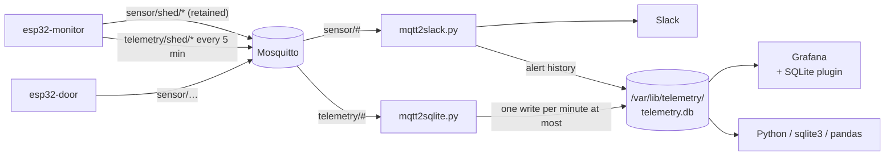

# Server: Slack Alerts and Time Series

This directory holds the server side of the shed monitor. It has two independent Python services:

| Service | Reads | Does |
|---------|-------|------|
| [`mqtt2slack.py`](#alert-service-mqtt2slack) | `sensor/#`: alert states from esp32-monitor and esp32-door (retained) | Posts state changes, STALE devices and COLD reminders to Slack, and records every alert. Replaces the Node-RED flow. |
| [`mqtt2sqlite.py`](#installation-ubuntu-2204) | `telemetry/#`: the ESP32's average, min and max every 5 minutes | Stores the time series in SQLite for Grafana |



The two services are separate on purpose: restarting or upgrading the database side never interrupts the alerts. Writing the alert history is best effort, so a database problem can't block Slack.

## Why This Design

The server is a small fanless PC (Celeron N3350, 4 GB RAM, 32 GB eMMC) that also runs Mosquitto and Node-RED, so the stack is kept light:

| Part | Footprint | Notes |
|------|-----------|-------|
| `mqtt2sqlite.py` | ~25 MB RAM | Python standard library plus `paho-mqtt` |
| SQLite | No server process | One file. Inserts are batched once a minute to keep eMMC writes low. |
| Grafana | ~150–200 MB RAM | Optional; you can also query the database from Python |
| Disk | ~50 MB per year | 4 rows every 5 minutes, plus small hourly summaries |

## What Is Stored

Each message's `type` field picks the table, and each numeric field becomes a column:

| Table | Contents | Kept |
|-------|----------|------|
| `power_5m` | `solar` and `battery`: `bus_voltage`, `current`, `power`, each with `_min` / `_max` | 2 years (`raw_retention_days`) |
| `env_5m` | `env`: `temperature_c`, `humidity`, each with `_min` / `_max` | 2 years |
| `device_5m` | `device`: `rssi`, `uptime_s`, `free_heap`, `min_free_heap`, `mqtt_connects` | 2 years |
| `power_1h`, `env_1h`, `device_1h` | Hourly summaries: weighted averages, the lowest `_min` and highest `_max` | Forever |

Every table has `ts` (Unix seconds, UTC), `hub` and `sensor`, plus `interval_s` and `samples`. The primary key is `(hub, sensor, ts)`, so a repeated message is ignored. Each 5-minute row also has `received`, the time the message arrived.

The hourly power tables also have energy and charge totals, calculated as average × interval ÷ 3600:

| Column | Meaning |
|--------|---------|
| `energy_wh`, `charge_ah` | Net energy (Wh) and charge (Ah) in the hour |
| `energy_in_wh`, `charge_in_ah` | Positive part: battery charging, or solar producing |
| `energy_out_wh`, `charge_out_ah` | Negative part, as a positive number: battery discharging |

Notes:
- A 5-minute point is stamped at the **end** of its interval (`ts`). It is counted in the hour that contains the **middle** of the interval, so a point at 10:00:03 belongs to 09:00–10:00.
- In/out totals are calculated from 5-minute averages. If the current changes direction within an interval, only the net amount is counted.
- The solar `power` uses the battery voltage, because the Keeper 1220 is common-positive (see the main README), so solar energy reads about 35 % low. The battery values are accurate.
- **The database follows the firmware.** A new numeric field from the firmware becomes a new column automatically, and a new `type` becomes a new table.

## Files

| File | Install to |
|------|------------|
| `mqtt2sqlite.py` | `/opt/mqtt2sqlite/mqtt2sqlite.py` |
| `requirements.txt` | Used to create `/opt/mqtt2sqlite/venv` |
| `mqtt2sqlite.ini.example` | `/etc/mqtt2sqlite/mqtt2sqlite.ini` |
| `systemd/mqtt2sqlite.service` | `/etc/systemd/system/mqtt2sqlite.service` |
| `grafana/provisioning/datasources/telemetry.yaml` | `/etc/grafana/provisioning/datasources/` |
| `grafana/provisioning/dashboards/telemetry.yaml` | `/etc/grafana/provisioning/dashboards/` |
| `grafana/dashboards/shed-monitor.json` | `/etc/grafana/dashboards/telemetry/` |
| `grafana/systemd/telemetry.conf` | `/etc/systemd/system/grafana-server.service.d/` |
| `mqtt2slack.py` | `/opt/mqtt2slack/mqtt2slack.py` |
| `mqtt2slack.ini.example` | `/etc/mqtt2slack/mqtt2slack.ini` |
| `systemd/mqtt2slack.service` | `/etc/systemd/system/mqtt2slack.service` |
| `tests/` | Not installed. Run the tests from the repository: `cd server && python3 -m unittest discover -s tests -v` |

## Installation (Ubuntu 22.04)

Run these on the server, from the root of a clone of this repository. Each step can be checked before you go on to the next one.

### 1. Packages

```bash
sudo apt install python3-venv sqlite3
```

### 2. MQTT User for the Ingester

Check how Mosquitto handles logins:

```bash
grep -rE "password_file|acl_file|allow_anonymous" /etc/mosquitto/
```

If a `password_file` is listed, add a `telemetry` user to it. This example assumes the file is `/etc/mosquitto/passwd`:

```bash
sudo mosquitto_passwd /etc/mosquitto/passwd telemetry
```

```bash
sudo systemctl reload mosquitto
```

If an `acl_file` is listed, add these lines to it, then reload Mosquitto again. The ESP32's user also needs `topic write telemetry/#`. `sensor/#` is for the alert service, which uses the same MQTT user.

```
user telemetry
topic read telemetry/#
topic read sensor/#
```

### 3. Service User and Database Directory

The directory is setgid (the `2` in `2775`), so every database file belongs to the `telemetry` group. Grafana joins that group in step 8.

```bash
sudo useradd --system --no-create-home --shell /usr/sbin/nologin telemetry
```

```bash
sudo install -d -o telemetry -g telemetry -m 2775 /var/lib/telemetry
```

### 4. Program and Python Environment

```bash
sudo install -d /opt/mqtt2sqlite
```

```bash
sudo install -m 644 server/mqtt2sqlite.py /opt/mqtt2sqlite/
```

```bash
sudo python3 -m venv /opt/mqtt2sqlite/venv
```

```bash
sudo /opt/mqtt2sqlite/venv/bin/pip install -r server/requirements.txt
```

Optionally, run the tests. They need no broker and no extra packages:

```bash
cd server && python3 -m unittest discover -s tests -v; cd ..
```

### 5. Configuration

```bash
sudo install -d /etc/mqtt2sqlite
```

```bash
sudo install -m 640 -g telemetry server/mqtt2sqlite.ini.example /etc/mqtt2sqlite/mqtt2sqlite.ini
```

```bash
sudo nano /etc/mqtt2sqlite/mqtt2sqlite.ini
```

Set `username` and `password` to the MQTT user from step 2. If Mosquitto allows anonymous logins, leave both empty.

### 6. Start the Service

```bash
sudo install -m 644 server/systemd/mqtt2sqlite.service /etc/systemd/system/
```

```bash
sudo systemctl daemon-reload
```

```bash
sudo systemctl enable --now mqtt2sqlite
```

```bash
journalctl -u mqtt2sqlite -f
```

You should see `MQTT connected, subscribing to telemetry/#`. Press Ctrl+C to stop following the log.

### 7. Test Without the ESP32 (Optional)

Publish a test message. Add `-u` and `-P` if your broker needs a login.

```bash
mosquitto_pub -h localhost -t telemetry/test/env -m '{"hub":"test","sensor":"env","type":"env","interval_s":300,"temperature_c":20.5}'
```

Within a minute, the log shows `Creating table env_5m`. Check the row:

```bash
sqlite3 /var/lib/telemetry/telemetry.db "SELECT * FROM env_5m"
```

Delete the test rows:

```bash
sudo -u telemetry sqlite3 /var/lib/telemetry/telemetry.db "DELETE FROM env_5m WHERE hub='test'; DELETE FROM env_1h WHERE hub='test'"
```

### 8. Grafana

Add Grafana's apt repository and install Grafana. These are Grafana's documented steps for Debian and Ubuntu:

```bash
sudo apt install -y apt-transport-https software-properties-common wget
```

```bash
sudo mkdir -p /etc/apt/keyrings
```

```bash
wget -q -O - https://apt.grafana.com/gpg.key | gpg --dearmor | sudo tee /etc/apt/keyrings/grafana.gpg > /dev/null
```

```bash
echo "deb [signed-by=/etc/apt/keyrings/grafana.gpg] https://apt.grafana.com stable main" | sudo tee /etc/apt/sources.list.d/grafana.list
```

```bash
sudo apt update && sudo apt install grafana
```

Install the SQLite plugin. Newer Grafana packages need the install folder (`--homepath`) and the config (`--config`, so the plugin goes into `/var/lib/grafana/plugins`); the older `grafana-cli` command fails with "Could not find config defaults":

```bash
sudo grafana cli --homepath /usr/share/grafana --config /etc/grafana/grafana.ini plugins install frser-sqlite-datasource
```

Check that it is listed:

```bash
sudo grafana cli --homepath /usr/share/grafana --config /etc/grafana/grafana.ini plugins ls
```

Let Grafana read the database. This is a systemd drop-in that adds the `telemetry` group and write access to the database directory, which SQLite needs for its `-shm` file:

```bash
sudo install -D -m 644 server/grafana/systemd/telemetry.conf /etc/systemd/system/grafana-server.service.d/telemetry.conf
```

Install the data source and the dashboard:

```bash
sudo install -m 644 server/grafana/provisioning/datasources/telemetry.yaml /etc/grafana/provisioning/datasources/
```

```bash
sudo install -m 644 server/grafana/provisioning/dashboards/telemetry.yaml /etc/grafana/provisioning/dashboards/
```

```bash
sudo install -D -m 644 server/grafana/dashboards/shed-monitor.json /etc/grafana/dashboards/telemetry/shed-monitor.json
```

Start Grafana:

```bash
sudo systemctl daemon-reload
```

```bash
sudo systemctl enable --now grafana-server
```

Open `http://rizz:3000/` (or the server's IP address) and log in as `admin` / `admin`. Grafana asks for a new password. The dashboard is under **Dashboards → Shed → Shed Monitor**.

**Optional: reduce Grafana's background work.** In `/etc/grafana/grafana.ini`, set the following, then restart Grafana:

```ini
[analytics]
reporting_enabled = false
check_for_updates = false
check_for_plugin_updates = false

[news]
news_feed_enabled = false
```

### 9. Firmware

Flash esp32-monitor v1.8. The first telemetry arrives 5 minutes after it boots.

## The Dashboard

| Section | Panels |
|---------|--------|
| Top row | Latest battery voltage and current, solar current, temperature, humidity and the ESP32's WiFi RSSI, colored by the alarm thresholds |
| Power | Battery voltage, battery current and solar current (average line with a min–max band), and power |
| Environment | Temperature (°F) and humidity, with lines at the alarm thresholds (COLD 35.6 °F, HOT 113 °F, HUMID 85 %RH) |
| Daily energy | Battery charged and discharged and solar Wh per day, for the last 30 days |
| ESP32 | The shed ESP32's WiFi RSSI, free heap and uptime (drops show reboots). These are the ESP32's own values, not the server's: about 140 KiB free heap (of about 320 KB RAM) is normal. |
| Recent alerts | Every alert from `mqtt2slack` in the time range |

Alerts are also drawn as red markers on every graph (the **Alerts** annotation). Reminders are left out of the markers. The markers can be turned off at the top of the dashboard.

The database stores temperature in °C (`temperature_c`); the dashboard queries convert it to °F (`temperature_c * 1.8 + 32`). Grafana's °F unit only changes the label, so the conversion has to be in the query.

Two variables at the top:
- **Resolution:** `5m` (5-minute points) or `1h` (hourly summaries). Use `1h` for ranges longer than about a month: it is faster, and 5-minute data is only kept for 2 years.
- **Hub:** `shed00`.

The dashboard is provisioned from the JSON file but can still be edited in Grafana. To keep your changes, export the JSON (**Share → Export**) and save it over `grafana/dashboards/shed-monitor.json`.

## Alert Service (mqtt2slack)

`mqtt2slack.py` replaces the Node-RED flow (MQTT in → RBE → format → rate limit → Slack). It posts the same alerts, with these differences:

| | Node-RED flow | mqtt2slack |
|---|---|---|
| Message | `Topic / New State / Timestamp` | Emoji, hub, sensor, state, previous state, readings, reason and time |
| After a restart | Posts every topic again (the RBE node forgets) | Compares with the saved states: only real changes are posted, including changes made while it was down |
| Internet or Slack down | Alert lost | Saved and sent later, marked "delivered late". After 24 h, combined into one summary. |
| Slack errors | Not checked | `ok: false`, HTTP 429 (`Retry-After`) and connection errors are handled; errors are logged |
| COLD | One alert | One alert, then a reminder every 6 hours while it lasts |
| History | — | `alerts` table in `telemetry.db`, shown in Grafana |
| Code | In `flows.json`, edited in the browser | In git, with tests |

### Slack Messages

A state change:

> 🪫 **shed00 Battery: LOW** (was OK)<br>
> 12.71 V · -1.42 A · -18.0 W<br>
> Low battery · 2026-11-01 22:15:03<br>
> `sensor/shed/battery`

A reminder, and the watchdog:

> ⏰ 🥶 **shed00 Shed Environment: COLD** (reminder)<br>
> 0.8 °C (33.4 °F) · 82 %RH<br>
> For 6 h 0 min · 2026-11-02 04:15:00

> ⏰ **door01 Watchdog: STALE**<br>
> No report for 16 min · 2026-11-01 22:31:00

### Rules

- **Change:** a topic's `state` differs from the last one seen, and the change is posted. Periodic updates with the same state are not.
- **New topic:** the first time a topic is seen, it is only posted if its state is not one of `normal_states` (`OK`, `ONLINE`, `CLOSED`, `REPORTING`). So the first start posts only the topics that are in an alarm state, plus the door if it is `OPEN`.
- **Watchdog:** `STALE` when a hub has sent nothing on `sensor/#` for 15 minutes (`stale_minutes`), and `REPORTING` when it sends again. esp32-monitor and esp32-door send a periodic update every 5 minutes. A hub whose last message is the broker's `OFFLINE` last will is not reported STALE, because OFFLINE was already posted.
- **Reminders:** `[reminders] COLD = 6` posts COLD again every 6 hours while it lasts. Other states can be added, e.g. `HIGH = 2`. A reminder says how long the state has lasted, and the age of the last report if it is older than 15 minutes.
- **Order and rate:** alerts are sent in order, at most 1 per second.

The alert state (`mqtt2slack-state.db`) is separate from `telemetry.db`, so deleting or rebuilding the telemetry database doesn't affect alerting.

### Install

These steps assume steps 1–5 above are done (the `telemetry` user, `/var/lib/telemetry`, the MQTT user).

```bash
sudo install -d /opt/mqtt2slack
```

```bash
sudo install -m 644 server/mqtt2slack.py /opt/mqtt2slack/
```

```bash
sudo python3 -m venv /opt/mqtt2slack/venv
```

```bash
sudo /opt/mqtt2slack/venv/bin/pip install -r server/requirements.txt
```

```bash
sudo install -d /etc/mqtt2slack
```

```bash
sudo install -m 640 -g telemetry server/mqtt2slack.ini.example /etc/mqtt2slack/mqtt2slack.ini
```

```bash
sudo nano /etc/mqtt2slack/mqtt2slack.ini
```

In the config, set:
- `[mqtt] username` / `password`: the same MQTT user as `mqtt2sqlite`.
- `[slack] token`: the bot token from Node-RED's **Send to Slack Alerts** node (the `Authorization` header, without `Bearer `).
- `[slack] channel`: `C0CE0HGN709` (`#test`) for now.

Invite the bot to `#test`: in Slack, open `#test` and type `/invite @YourBotName`. Then send a test message:

```bash
sudo -u telemetry /opt/mqtt2slack/venv/bin/python /opt/mqtt2slack/mqtt2slack.py -c /etc/mqtt2slack/mqtt2slack.ini --test-slack
```

`Slack test message sent` means the token and channel are right. `not_in_channel` means the bot has not been invited yet.

Start the service:

```bash
sudo install -m 644 server/systemd/mqtt2slack.service /etc/systemd/system/
```

```bash
sudo systemctl daemon-reload
```

```bash
sudo systemctl enable --now mqtt2slack
```

```bash
journalctl -u mqtt2slack -f
```

At start you should see `MQTT connected, subscribing to sensor/#`, then `New topic ... (not posted)` for each topic in a normal state.

### Test Next to Node-RED

Run both for a few days. Node-RED keeps posting to `#alerts`, and mqtt2slack posts to `#test`. Every alert in `#alerts` should also be in `#test`.

Ways to cause alerts:
- Unplug the shed ESP32: `OFFLINE` after about 90 s, then `ONLINE` (was OFFLINE) when it is back.
- Open the gate: `OPEN`, then `CLOSED`.
- Restart the service with `sudo systemctl restart mqtt2slack`: nothing should be posted.

### Switch Over

1. Change `channel` in `/etc/mqtt2slack/mqtt2slack.ini` to `C09MEBURHEE` (`#alerts`).
2. Stop Node-RED, and keep it from starting at boot. It is still installed, so you can go back.

```bash
sudo systemctl disable --now nodered
```

If that says the unit is not found, find the service name with `systemctl list-units --type=service | grep -i red`.

3. Restart mqtt2slack:

```bash
sudo systemctl restart mqtt2slack
```

4. **To go back:** run `sudo systemctl enable --now nodered`, and stop mqtt2slack or change its channel back to `#test`.

After a few weeks without problems, Node-RED can be removed. If you installed it with the Node-RED install script, the same script removes it (see the Node-RED documentation). Remember to keep a copy of `flows.json`.

### Operation

| Task | Command |
|------|---------|
| Follow the log | `journalctl -u mqtt2slack -f` |
| Test Slack | `sudo -u telemetry /opt/mqtt2slack/venv/bin/python /opt/mqtt2slack/mqtt2slack.py -c /etc/mqtt2slack/mqtt2slack.ini --test-slack` |
| Forget all devices (after removing one) | `sudo systemctl stop mqtt2slack`, then run the program with `--reset-watchdog` as above, then `sudo systemctl start mqtt2slack` |
| See waiting alerts | `sqlite3 /var/lib/telemetry/mqtt2slack-state.db "SELECT id, datetime(created, 'unixepoch', 'localtime'), substr(text, 1, 60) FROM outbox"` |
| Recent alert history | `sqlite3 /var/lib/telemetry/telemetry.db "SELECT datetime(ts, 'unixepoch', 'localtime'), hub, sensor, state, previous, kind FROM alerts ORDER BY ts DESC LIMIT 20"` |
| Upgrade | `sudo install -m 644 server/mqtt2slack.py /opt/mqtt2slack/ && sudo systemctl restart mqtt2slack` |

### Troubleshooting

| Log message | Meaning |
|-------------|---------|
| `Slack refused the message: invalid_auth` | Wrong token. Copy it again from Node-RED, without `Bearer `. |
| `Slack refused the message: not_in_channel` | Invite the bot to the channel (`/invite @YourBotName`). |
| `Slack refused the message: channel_not_found` | Use the channel **ID** (`C0...`), not the name. |
| `Slack post failed (connection failed ...)` | No internet. Alerts wait in the outbox and are sent when it returns. |
| `MQTT connect failed: Not authorized` | MQTT user, password or ACL (step 2). |

After fixing the config, restart the service. Messages refused with a configuration error are kept and retried every 10 minutes, so nothing is lost while you fix it.

## Ingester Operation

### Logs

```bash
journalctl -u mqtt2sqlite --since today
```

The service logs once an hour (`Last hour: 48 messages, 48 stored, 0 ignored`), plus any warnings. Set `level = DEBUG` in the config to see every write.

### Disk Usage

```bash
du -h /var/lib/telemetry/
```

### Backup

The backup command is safe while the service is running. Copy the backup file to another machine.

```bash
sqlite3 /var/lib/telemetry/telemetry.db ".backup '/home/dfannin/telemetry-backup.db'"
```

### Rebuild the Hourly Summaries

Use this after changing data by hand, or after an upgrade that changes how summaries are calculated:

```bash
sudo systemctl stop mqtt2sqlite
```

```bash
sudo -u telemetry /opt/mqtt2sqlite/venv/bin/python /opt/mqtt2sqlite/mqtt2sqlite.py -c /etc/mqtt2sqlite/mqtt2sqlite.ini --rebuild-hourly
```

```bash
sudo systemctl start mqtt2sqlite
```

### Upgrade the Ingester

```bash
sudo install -m 644 server/mqtt2sqlite.py /opt/mqtt2sqlite/ && sudo systemctl restart mqtt2sqlite
```

## Querying the Data

### SQL

Daily battery energy and charge, using local dates:

```sql
SELECT date(ts, 'unixepoch', 'localtime') AS day,
       ROUND(SUM(energy_in_wh), 1)  AS charged_wh,
       ROUND(SUM(energy_out_wh), 1) AS discharged_wh,
       ROUND(SUM(charge_ah), 2)     AS net_ah
FROM power_1h
WHERE hub = 'shed00' AND sensor = 'battery'
GROUP BY day ORDER BY day DESC LIMIT 14;
```

Coldest and warmest hour per day:

```sql
SELECT date(ts, 'unixepoch', 'localtime') AS day,
       MIN(temperature_c_min) AS low_c, MAX(temperature_c_max) AS high_c
FROM env_1h GROUP BY day ORDER BY day DESC LIMIT 14;
```

### Python / pandas

```python
import sqlite3
import pandas as pd

db = sqlite3.connect("file:/var/lib/telemetry/telemetry.db?mode=ro", uri=True)
df = pd.read_sql(
    "SELECT ts, bus_voltage, current FROM power_5m "
    "WHERE hub = 'shed00' AND sensor = 'battery' AND ts >= strftime('%s', 'now', '-7 days')",
    db)
df["time"] = pd.to_datetime(df["ts"], unit="s", utc=True).dt.tz_convert("America/Los_Angeles")
print(df.set_index("time").resample("1D")[["bus_voltage", "current"]].agg(["min", "mean", "max"]))
```

## Troubleshooting

### Grafana: "attempt to write a readonly database" or "unable to open database file"
- Check the directory: `ls -ld /var/lib/telemetry` should show `drwxrwsr-x telemetry telemetry`. The `s` is the setgid bit.
- Check that the drop-in is active: `systemctl show grafana-server -p SupplementaryGroups` should show `telemetry`. If it doesn't, run `sudo systemctl daemon-reload` and restart Grafana.
- Check the database files: `ls -l /var/lib/telemetry` should show group `telemetry` and `rw` for the group.

### Grafana Panels Say "No data"
- No telemetry yet: the tables are created by the first message. Check with `sqlite3 /var/lib/telemetry/telemetry.db .tables`.
- The **Hub** variable must match `mqtt_client_id` (`shed00`).
- Watch the raw messages: `mosquitto_sub -h localhost -t 'telemetry/#' -v`.

### Service Does Not Connect to MQTT
- `journalctl -u mqtt2sqlite` shows `MQTT connect failed: Not authorized` if the username, password or ACL is wrong (step 2).

### Messages Are "ignored"
- The log says why, for example `not valid JSON` or `missing or invalid "type"`. Only messages with `hub`, `type` and at least one numeric field are stored.

### Time Is Wrong on the Graphs
- Points use the ESP32's `epoch`. Until the ESP32 has synced NTP, it sends `uptime_ms` instead, and the time the message arrived is used. Grafana shows times in the browser's timezone.
